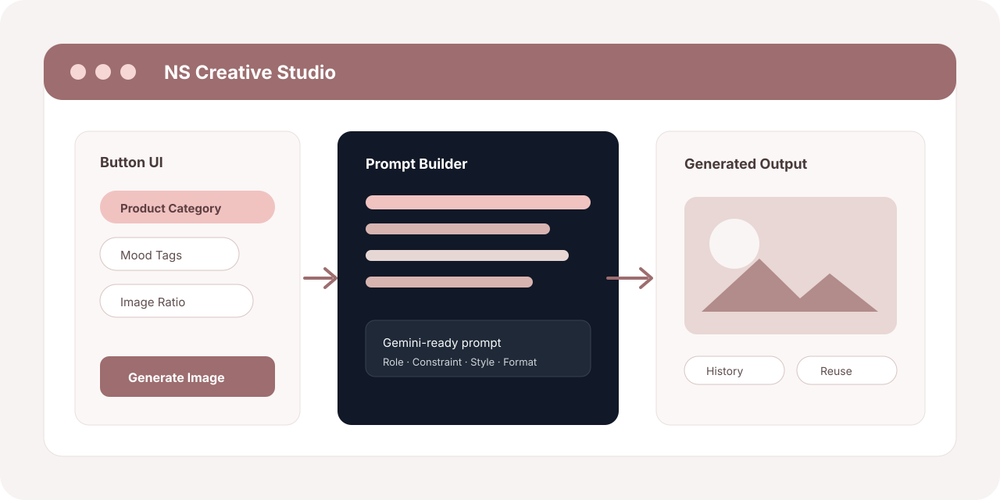
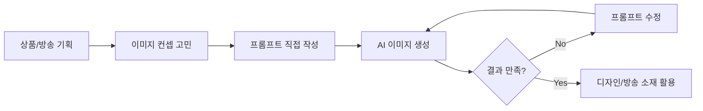
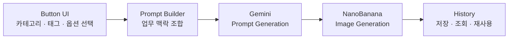
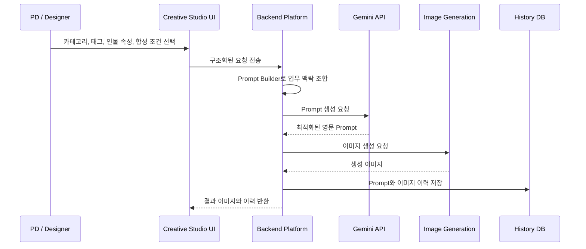
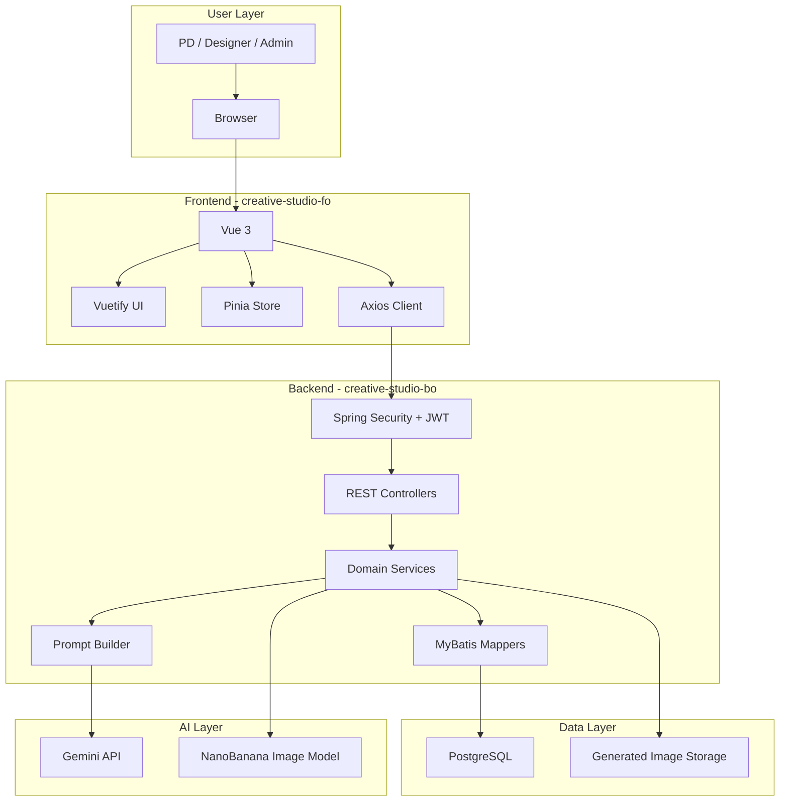
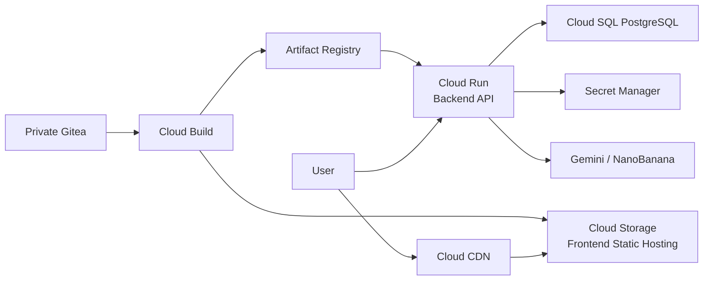

# NS Creative Studio

> **AI-based content creation platform for NS Home Shopping**
>
> 프롬프트를 잘 쓰는 사람만 AI를 쓸 수 있는 것이 아니라,  
> 현업 사용자가 버튼 몇 번으로 방송/커머스 이미지를 만들 수 있도록 설계한 AI Product Platform입니다.



## What This Product Does

NS Creative Studio는 NS홈쇼핑에서 실제 운영 중인 AI 기반 콘텐츠 제작 플랫폼입니다.

현업 PD와 디자이너가 상품 카테고리, 이미지 스타일, 인물 속성, 합성 조건을 선택하면 시스템이 자동으로 최적화된 Prompt를 생성하고, Gemini/NanoBanana 기반 이미지 생성까지 이어줍니다.

이 프로젝트는 사내 AI 공모전 MVP 1위를 수상한 뒤 실제 서비스로 운영되고 있으며, 현재 방송 이미지 제작과 NS홈쇼핑 앱 배너 제작에 활용되고 있습니다.

### Impact

| Metric | Before | After |
|---|---:|---:|
| Prompt writing time | 약 30분 | 약 1분 |
| Content production productivity | 기준 업무 | 1.7배 향상 |
| Internal validation | 아이디어 단계 | 사내 AI 공모전 MVP 1위 |
| Production usage | 없음 | 방송 이미지 / 앱 배너 제작 활용 |

### Built With

`Spring Boot` · `Vue 3` · `PostgreSQL` · `MyBatis` · `JWT` · `Gemini API` · `NanoBanana` · `Docker` · `GCP-ready Architecture`

---

## 1. Problem

생성형 AI는 이미 충분히 강력했습니다. 하지만 현업 사용자가 실제 업무에 쓰기에는 장벽이 높았습니다.

기존 업무 흐름은 이랬습니다.



현업 사용자의 Pain Point는 명확했습니다.

- 어떤 프롬프트를 써야 하는지 모른다.
- 원하는 이미지를 얻기 위해 수십 번 문장을 바꿔야 한다.
- 상품 이미지, 방송 문구, 모델 컷, 앱 배너마다 요구사항이 달라진다.
- AI 사용 경험이 없는 PD/디자이너에게 Prompt Engineering은 별도의 전문 역량처럼 느껴진다.
- 좋은 결과가 나와도 히스토리와 재사용 체계가 없어 팀 단위 자산으로 남지 않는다.

즉, 문제는 이미지 생성 모델 자체가 아니었습니다.

문제는 **현업 사용자가 AI를 사용하는 방식**이었습니다.

---

## 2. Insight

제가 정의한 문제는 단순했습니다.

> **AI가 부족한 것이 아니라, AI를 사용하는 UX가 부족했다.**

많은 AI 도구는 사용자에게 빈 텍스트 박스를 제공합니다.

하지만 커머스 현업의 업무 방식은 텍스트 박스 중심이 아닙니다. 사용자는 “더 예쁜 프롬프트”를 쓰고 싶은 것이 아니라, “이번 방송 상품에 맞는 이미지”가 필요합니다.

그래서 제품의 중심을 Prompt 입력창이 아니라 **업무 선택지**로 옮겼습니다.

- 상품군은 카테고리로 선택한다.
- 스타일은 태그로 선택한다.
- 인물 이미지는 속성 옵션으로 선택한다.
- 합성 이미지는 상품 이미지와 인물 이미지를 올리고 상황을 입력한다.
- AI에게 전달할 Prompt는 시스템이 조합하고 최적화한다.

이 접근은 사용자를 Prompt Engineer로 만들지 않습니다.  
대신 제품이 Prompt Engineer 역할을 대신합니다.

---

## 3. Solution

NS Creative Studio는 사용자의 업무 선택을 AI가 이해할 수 있는 Prompt로 변환하는 Product Layer입니다.



### Product Flow



이 제품의 핵심은 “AI 호출”이 아니라, 사용자의 업무 의도를 구조화해서 AI가 잘 이해할 수 있는 형태로 바꾸는 것입니다.

---

## 4. Product Features

### Guided Prompt Creation

사용자는 프롬프트를 직접 작성하지 않습니다.  
상품 카테고리와 스타일 태그를 선택하면 시스템이 상품 맥락, 이미지 분위기, 출력 목적을 조합해 Prompt를 생성합니다.

**User Value:** AI 사용 경험이 없어도 안정적인 결과물을 얻을 수 있습니다.

### Product Image Generation

상품군, 이미지 비율, 스타일, 참조 이미지를 기반으로 커머스용 상품 이미지를 생성합니다.

**User Value:** 상품 상세, 앱 배너, 방송 보조 이미지 제작 시간을 줄입니다.

### Human Image Prompt Builder

인물 수, 표정, 시선, 의상, 헤어, 배경, 촬영 기술 등을 단계별 옵션으로 선택합니다.

**User Value:** 모델 컷처럼 조건이 복잡한 이미지도 텍스트 작성 없이 일관된 방식으로 생성할 수 있습니다.

### Product + Human Fusion

상품 이미지와 인물 이미지를 업로드하고, 포즈/상황/문구 조건을 입력하면 자연스러운 합성 이미지를 생성합니다.

**User Value:** 방송/커머스 소재에 필요한 “사람이 상품을 들고 있는 이미지” 같은 활용도 높은 장면을 빠르게 제작할 수 있습니다.

### Text Overlay Image Generation

기존 이미지 위에 방송 자막형 문구와 단서 문구를 합성합니다.

**User Value:** 홈쇼핑 이미지 제작에서 중요한 문구 강조와 법적/상품 고지 표현을 빠르게 시각화할 수 있습니다.

### Prompt & Image History

생성된 Prompt, 선택 옵션, 이미지 결과를 저장하고 검색할 수 있습니다.

**User Value:** 좋은 결과물을 팀 자산으로 재사용할 수 있고, 반복 실험 비용을 줄일 수 있습니다.

### Role-based Admin System

ADMIN, MANAGER, USER 권한을 나누고 사용자/카테고리/태그/인물 속성을 관리합니다.

**User Value:** PoC가 아니라 실제 조직 운영에 필요한 관리 체계를 제공합니다.

---

## 5. Architecture

NS Creative Studio는 Frontend, Backend, Database, External AI API가 분리된 구조입니다.



### Deployment Direction



Architecture detail: [docs/ARCHITECTURE.md](docs/ARCHITECTURE.md)

---

## 6. Engineering Decisions

### Why JWT?

이 서비스는 사내 업무 도구이며, 프론트엔드와 백엔드가 분리되어 있습니다.  
세션 기반 인증보다 Stateless JWT가 배포와 확장에 단순했고, API 서버를 Cloud Run 같은 컨테이너 환경에서 운영하기에도 적합했습니다.

Access Token은 1시간으로 제한하고, PoC/MVP 단계에서는 Refresh Token을 제외했습니다. 복잡한 인증 플로우보다 빠른 검증과 운영 안정성을 우선했습니다.

### Why Role-based Access Control?

현업 서비스에는 세 가지 사용자가 존재했습니다.

- 콘텐츠를 생성하는 일반 사용자
- 카테고리/태그를 관리하는 운영자
- 계정과 전체 데이터를 관리하는 관리자

그래서 `ADMIN > MANAGER > USER` 계층을 만들었습니다.  
별도 Role 테이블을 두지 않고 User의 `role` 컬럼으로 단순화한 이유는, 초기 운영 범위에서 역할 종류가 고정되어 있었고 동적 권한 조합보다 빠른 제품 검증이 더 중요했기 때문입니다.

### Why Prompt Builder?

사용자에게 빈 Prompt 입력창을 주면 제품의 핵심 문제가 다시 사용자에게 돌아갑니다.

Prompt Builder는 사용자의 선택값을 AI 친화적인 문맥으로 변환합니다.

- 상품 카테고리 → 제품 맥락
- 태그 → 스타일과 분위기
- 인물 속성 → 촬영 조건
- 이미지 비율 → 출력 제약
- 문구/단서 → 커머스 표현 제약

즉, Prompt Builder는 UI와 AI 모델 사이의 Product Intelligence Layer입니다.

### Why History?

AI 생성 결과는 한 번에 끝나는 산출물이 아니라 반복 실험의 결과입니다.

History를 저장한 이유는 세 가지입니다.

1. 좋은 Prompt를 팀 단위로 재사용하기 위해
2. 어떤 선택값이 좋은 결과를 만들었는지 추적하기 위해
3. 생성 이미지와 업무 결과를 연결해 운영 자산으로 남기기 위해

History는 단순 로그가 아니라 AI Workflow의 Memory입니다.

### Why Gemini?

프롬프트 생성 단계에서는 긴 문맥을 안정적으로 이해하고, 구조화된 조건을 자연스러운 영어 이미지 프롬프트로 바꾸는 능력이 중요했습니다.

Gemini는 상품 카테고리, 태그, 인물 속성, 추가 지시사항을 조합해 커머스 이미지 생성에 적합한 Prompt를 만들기에 적합했습니다.

이미지 생성 단계에서는 NanoBanana 계열 모델을 사용해 Prompt에서 이미지까지 이어지는 end-to-end 경험을 구성했습니다.

### Why MyBatis instead of JPA?

이 프로젝트는 관리자성 CRUD, 검색 필터, 이력 조회, 계층형 카테고리, 배치성 상세 조회가 많습니다.

MyBatis는 SQL을 명시적으로 제어할 수 있어 다음 요구에 적합했습니다.

- 카테고리 계층 조회
- Prompt History 검색 필터
- 이력 상세 batch 조회
- 운영 중 SQL 튜닝 가능성

### Why Docker?

백엔드, 프론트엔드, DB 초기화 구조를 환경에 독립적으로 유지하기 위해 Docker를 사용했습니다.

로컬에서는 PostgreSQL 컨테이너로 빠르게 개발 환경을 만들고, 운영 방향은 Cloud Run 기반 컨테이너 배포로 확장할 수 있도록 설계했습니다.

---

## 7. Prompt Engineering

이 제품의 Prompt Engineering 철학은 “멋진 문장 생성”이 아니라 **업무 의도를 안정적으로 이미지 모델에 전달하는 것**입니다.

### Role

AI에게 단순한 문장 생성기가 아니라 커머스 이미지 제작 전문가 역할을 부여합니다.

예:

- product photography expert
- commercial image prompt engineer
- home shopping visual director
- model photography director

### Constraint

현업 이미지에는 제약이 많습니다.

- 상품 형태를 왜곡하지 않을 것
- 참조 이미지의 색상과 재질을 유지할 것
- 방송/커머스 소재에 맞는 표현을 사용할 것
- 이미지 비율을 준수할 것
- 단서 문구나 강조 문구를 누락하지 않을 것

이 제약을 시스템 프롬프트와 후처리 suffix로 분리해 안정성을 높였습니다.

### Output Format

이미지 모델이 바로 사용할 수 있도록 영어 Prompt를 생성합니다.

MidJourney 스타일과 NanoBanana 스타일을 구분해, 같은 사용자 선택값도 모델별로 적합한 표현 방식으로 변환합니다.

### Style

스타일은 사용자가 직접 긴 문장으로 쓰지 않고 태그로 선택합니다.

예:

- 밝은
- 고급스러운
- 자연광
- 스튜디오
- 감성적인
- 커머스 상세페이지형

이 태그는 Prompt Builder에서 촬영 톤, 조명, 배경, 구도, 질감 표현으로 확장됩니다.

### Consistency

좋은 Prompt는 한 번 잘 나오는 것보다 반복해서 안정적으로 나와야 합니다.

그래서 선택형 UI, Prompt Builder, History 저장을 연결해 다음을 보장하려고 했습니다.

- 같은 조건이면 유사한 품질의 Prompt가 나온다.
- 좋은 결과는 다시 찾을 수 있다.
- 팀 내에서 Prompt 품질이 개인 역량에만 의존하지 않는다.

---

## 8. Tech Stack

| Area | Tech | Why |
|---|---|---|
| Frontend | Vue 3 | 빠른 화면 개발과 Composition API 기반 상태 구성이 적합 |
| UI | Vuetify | 관리자/업무 도구에 필요한 테이블, 폼, 다이얼로그, 탭 UI를 빠르게 구성 |
| State | Pinia | 인증 상태와 화면 복원 상태를 단순하게 관리 |
| Backend | Spring Boot | 사내 운영 API, 보안, 설정, 배포 표준에 적합 |
| Security | Spring Security + JWT | Stateless API 인증과 Role 기반 접근 제어 구현 |
| Database | PostgreSQL | 이력, 계층형 카테고리, 운영 데이터 저장에 안정적 |
| Persistence | MyBatis | 명시적 SQL 제어와 검색/계층/이력 조회 튜닝에 적합 |
| AI | Gemini API | 구조화된 업무 조건을 고품질 Prompt로 변환 |
| Image | NanoBanana | Prompt 기반 이미지 생성과 참조 이미지 활용 |
| Infra | Docker | 로컬/운영 환경 차이를 줄이고 Cloud Run 배포 방향과 호환 |

Technical detail: [docs/TECHNICAL.md](docs/TECHNICAL.md)

---

## 9. API Overview

NS Creative Studio API는 `/api` prefix를 사용하며, 대부분의 요청은 JWT 인증이 필요합니다.

### Core APIs

| Domain | Endpoint | Purpose |
|---|---|---|
| Auth | `POST /api/auth/login` | 자체 로그인 |
| Auth | `GET /api/auth/nsist-login` | NSIST SSO 로그인 |
| Users | `/api/users` | 사용자/권한/사용량 관리 |
| Categories | `/api/categories` | 상품 카테고리 관리 |
| Tags | `/api/tag-groups`, `/api/tags` | 스타일 태그 관리 |
| Product Prompt | `POST /api/prompts/goods` | 상품 프롬프트 생성 |
| Product Image | `POST /api/prompts/goods/generate-image` | 상품 이미지 생성 |
| Human Prompt | `POST /api/human-prompts` | 인물 프롬프트 생성 |
| Human Image | `POST /api/human-prompts/generate-image` | 인물 이미지 생성 |
| Fusion | `POST /api/prompts/fusion/generate-image` | 상품+인물 합성 |
| Text Overlay | `POST /api/prompts/fusion/text-overlay` | 이미지 문구 합성 |
| History | `GET /api/prompts` | 생성 이력 조회 |

### Common Response

```json
{
  "code": 200,
  "message": "OK",
  "data": {}
}
```

Full API summary: [docs/API.md](docs/API.md)

---

## 10. Project Results

이 프로젝트는 단순 PoC로 끝나지 않고 실제 업무에 연결되었습니다.

- 프롬프트 작성 시간: **30분 → 1분**
- 콘텐츠 제작 생산성: **1.7배 향상**
- 사내 AI 공모전: **MVP 1위**
- 실제 방송 이미지 제작 활용
- NS홈쇼핑 앱 배너 제작 활용
- PD/디자이너가 직접 AI 이미지 제작 플로우를 사용할 수 있는 내부 플랫폼으로 운영

가장 큰 성과는 “AI 모델을 붙였다”가 아니라,  
현업 사용자가 AI를 실제 업무 흐름 안에서 쓸 수 있게 만들었다는 점입니다.

---

## 11. Lessons Learned

### 1. AI Product의 병목은 모델이 아니라 UX일 수 있다

생성형 AI 프로젝트를 시작하면 모델 성능부터 보게 됩니다.  
하지만 실제 사용자는 모델의 파라미터보다 “어디를 눌러야 원하는 결과가 나오는지”를 더 중요하게 느낍니다.

이번 프로젝트에서 핵심은 더 좋은 모델을 찾는 것이 아니라, 모델을 업무 언어로 사용할 수 있게 만드는 것이었습니다.

### 2. Prompt Engineering은 UI 설계와 분리될 수 없다

좋은 Prompt는 좋은 입력 구조에서 나옵니다.

카테고리, 태그, 인물 속성, 이미지 비율, 문구 같은 UI 선택지는 곧 Prompt의 재료입니다.  
따라서 Prompt Engineering은 백엔드 문자열 조합만의 문제가 아니라 Product Design의 일부였습니다.

### 3. History는 AI 제품의 신뢰를 만든다

AI 결과는 매번 달라질 수 있습니다.  
사용자는 좋은 결과가 나왔을 때 다시 찾고 싶어 합니다.

History를 저장하면서 AI 결과는 일회성 실험이 아니라 팀의 제작 자산이 되었습니다.

### 4. MVP는 작게 만들어도 운영 구조는 필요하다

사내 공모전 MVP에서 출발했지만 실제 서비스로 이어지려면 권한, 사용자 관리, 이력 삭제, 업로드 검증, SSO, 배포 구조가 필요했습니다.

AI 기능만 만든 것이 아니라 운영 가능한 제품으로 확장한 것이 중요했습니다.

### 5. Product Engineer는 문제를 기술명으로 정의하지 않는다

처음부터 “Gemini로 무엇을 만들까?”라고 접근했다면 단순 프롬프트 생성기가 되었을 것입니다.

대신 “PD와 디자이너가 왜 AI를 쓰기 어려워하는가?”에서 출발했기 때문에, 버튼 기반 Prompt Builder와 이미지 생성 플랫폼이라는 형태가 나왔습니다.

---

## 12. Repository Guide

```text
nsonge_project/
├── creative-studio-bo/       # Spring Boot backend
├── creative-studio-fo/       # Vue frontend
└── docs/
    ├── API.md
    ├── ARCHITECTURE.md
    └── TECHNICAL.md
```

### Local Run

Backend:

```bash
cd creative-studio-bo
docker compose up -d
./gradlew bootRun
```

Frontend:

```bash
cd creative-studio-fo
npm install
npm run local
```

Useful links:

- Frontend: `http://localhost:3000`
- Backend API: `http://localhost:8080/api`
- Swagger UI: `http://localhost:8080/swagger-ui/index.html`

---

## Documentation

- [Technical Documentation](docs/TECHNICAL.md)
- [API Documentation](docs/API.md)
- [Architecture Documentation](docs/ARCHITECTURE.md)
- [Backend Requirements](creative-studio-bo/docs/requirements.md)
- [Backend ERD](creative-studio-bo/docs/erd.md)
- [Frontend Pages](creative-studio-fo/docs/pages.md)
