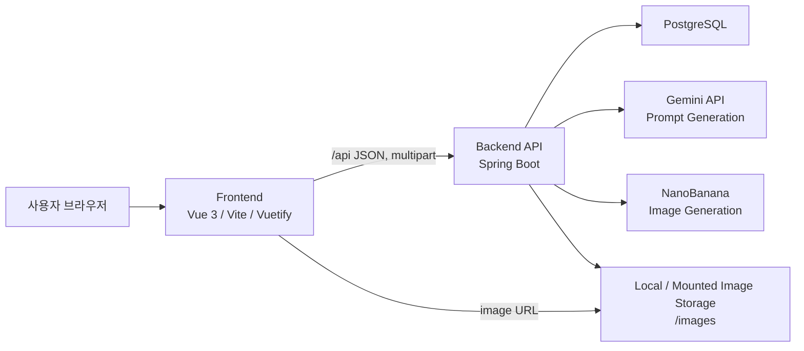
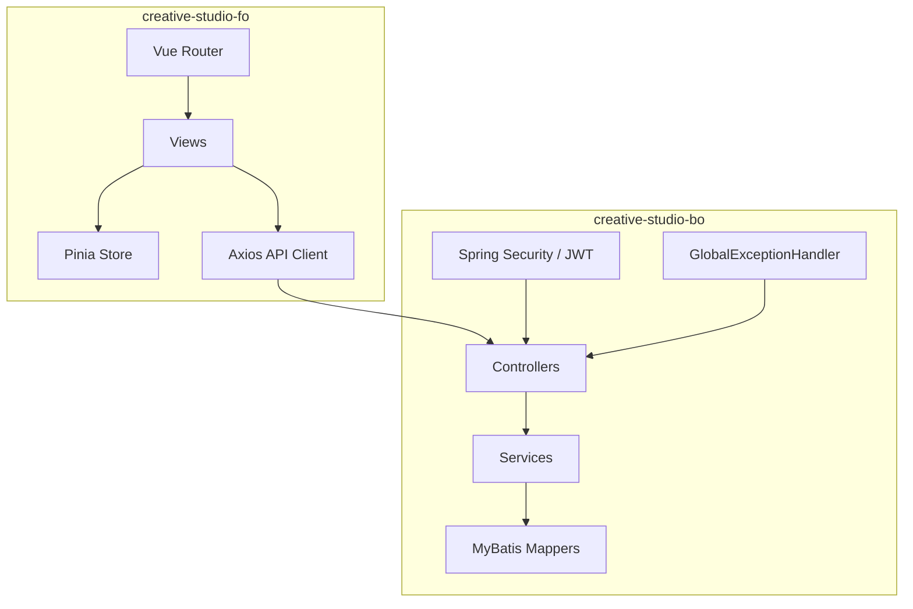
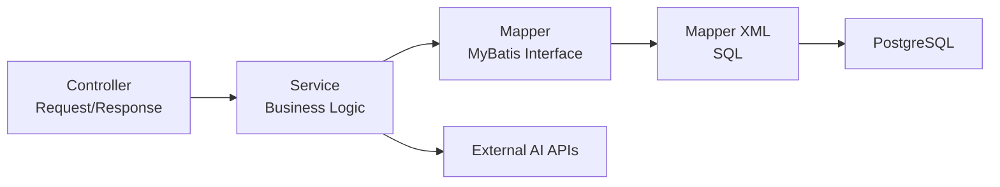
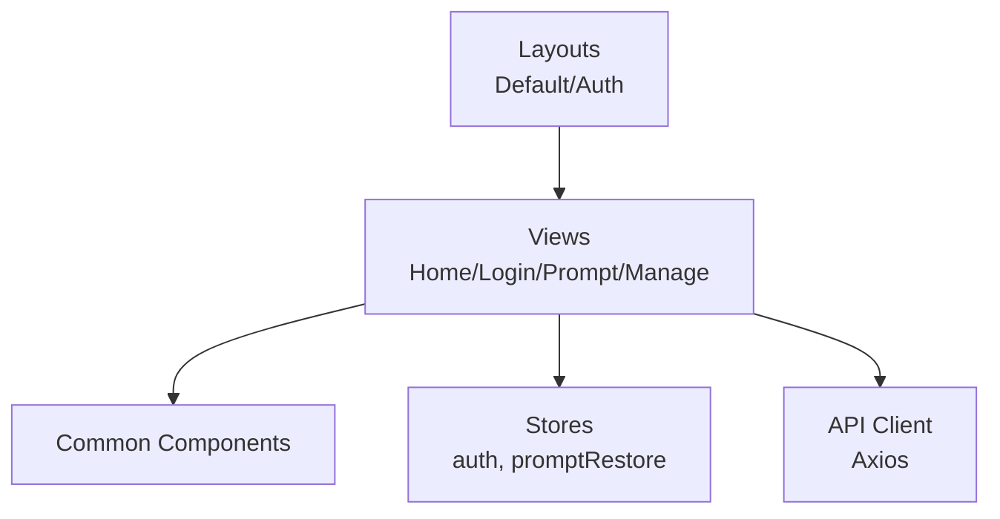
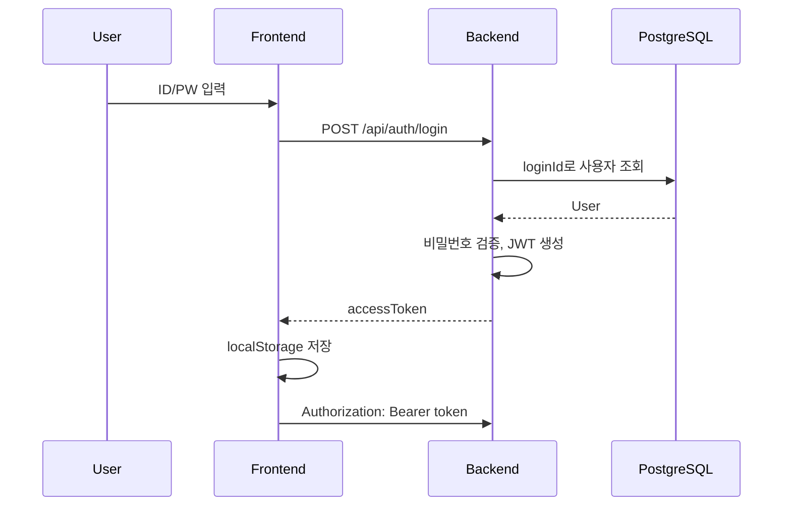
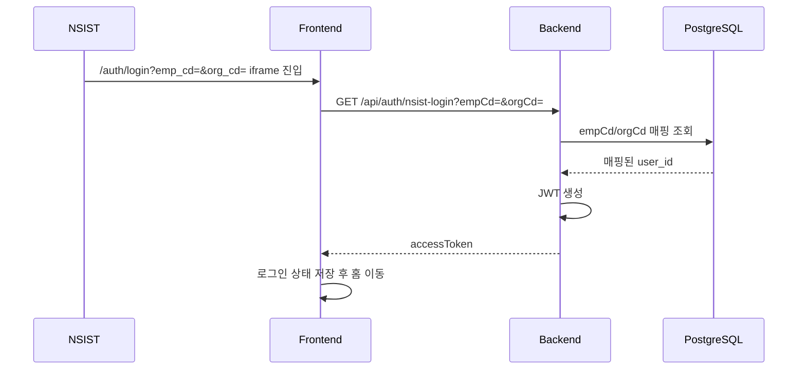
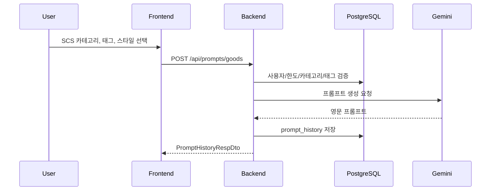
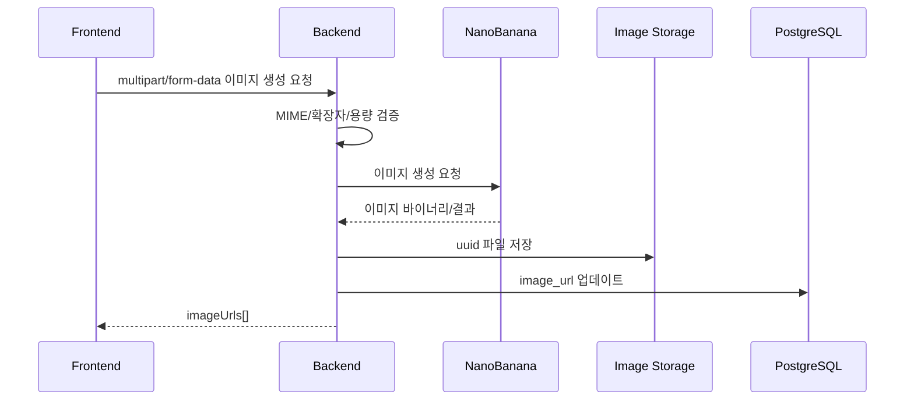
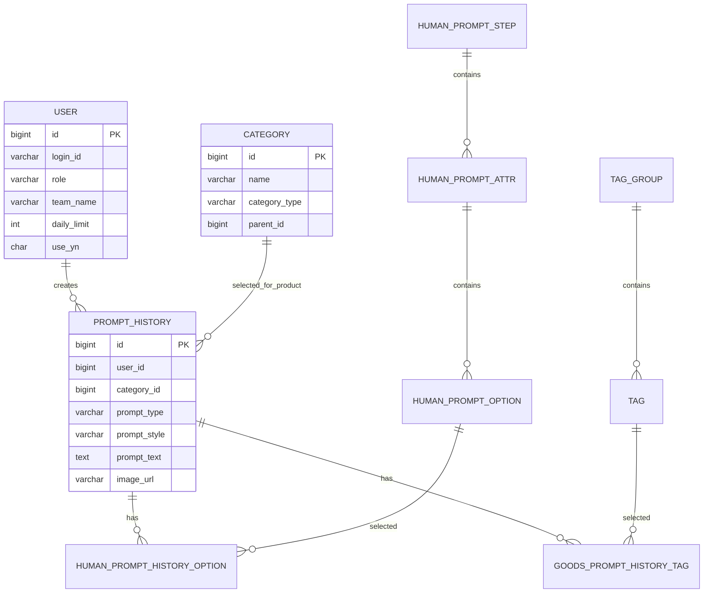
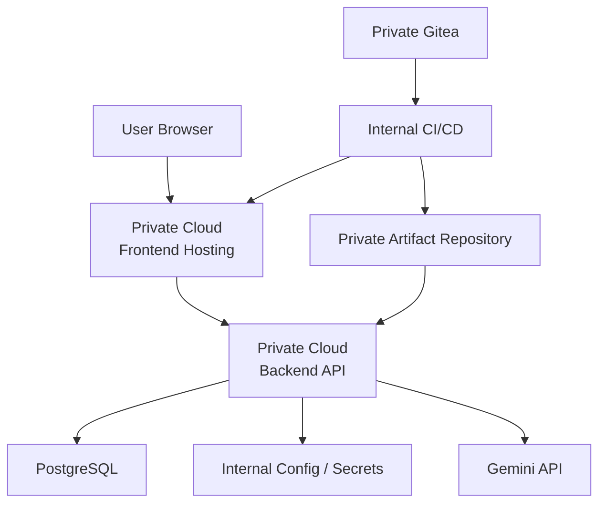

# Architecture 문서

## 1. 전체 구조

## 2. 런타임 구성

| 구성요소 | 역할 |
|---|---|
| Browser | 사용자가 접근하는 웹 UI |
| Frontend | 정적 파일로 배포되는 Vue 애플리케이션 |
| Backend | API, 인증, 권한, 비즈니스 로직 |
| PostgreSQL | 사용자, 카테고리, 태그, 이력, 매핑 데이터 저장 |
| Gemini API | 상품/인물 프롬프트 생성 |
| NanoBanana image model | 상품/인물/합성/텍스트 이미지 생성 |
| Image Storage | 생성 이미지 파일 저장 및 `/images/**` 공개 |

## 3. 논리 아키텍처

## 4. Backend Layer

### Controller

- `/api/**` 엔드포인트를 제공합니다.
- `@PreAuthorize`로 권한을 제어합니다.
- 요청 DTO 검증 후 Service를 호출합니다.
- 응답은 `CommonResponse<T>`로 반환합니다.

### Service

- 핵심 비즈니스 규칙을 담당합니다.
- 일일 한도 체크, 참조 무결성 검증, 외부 AI API 호출, 이력 저장을 수행합니다.
- 클래스 레벨 `@Transactional(readOnly = true)`와 CUD 메서드 `@Transactional` 패턴을 사용합니다.

### Mapper

- MyBatis Mapper 인터페이스와 XML 쿼리로 DB를 조회/수정합니다.
- DB FK 제약이 없으므로 삭제/수정 전 참조 여부를 Service에서 확인합니다.

## 5. Frontend Layer

### Layout

- `AuthLayout`: 로그인 전 화면
- `DefaultLayout`: 로그인 후 사이드바/앱바 포함 화면

### Store

- `auth`: JWT, 로그인 사용자, role 관리
- `promptRestore`: 이력에서 생성 화면 복원 시 사용

### API Client

- JWT 자동 주입
- 401 응답 시 인증 상태 초기화 및 로그인 화면 이동
- `VITE_API_BASE_URL` 기반 base URL 설정

## 6. 인증 흐름

## 7. NSIST SSO 흐름

## 8. 상품 프롬프트 생성 흐름

## 9. 이미지 생성 흐름

## 10. 데이터 모델 요약

## 11. 배포 아키텍처

실제 운영 환경은 사내 Private Cloud 기반입니다.

## 12. 보안 포인트

- JWT Stateless 인증
- `ADMIN > MANAGER > USER` 역할 계층
- Swagger UI는 운영 환경 노출 여부 점검 필요
- `/images/**`는 공개 경로입니다.
- 업로드 이미지는 MIME 타입, 확장자, 파일 크기를 검증합니다.
- 실제 시크릿은 `.env` 또는 Secret Manager로 관리하고 Git에 커밋하지 않습니다.

## 13. 확장 포인트

- Refresh Token 도입
- 이미지 파일을 로컬 디스크에서 Object Storage로 이전
- DB FK 제약 또는 정합성 검사 배치 도입
- AI 모델 교체 가능하도록 provider abstraction 강화
- 프론트 테스트 도구 도입
- 운영 모니터링/알림 대시보드 구성
